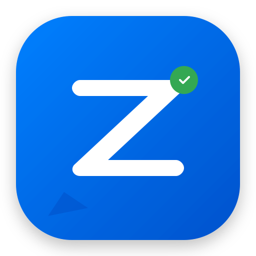

<div align="center">



# Zalos

**High-performance, ultra-lightweight native Qt 6 client for Zalo on Linux**

[](https://github.com/cpfriend1721994/zalos/actions/workflows/ci.yml)
[](https://github.com/cpfriend1721994/zalos/releases/latest)
[](https://github.com/cpfriend1721994/zalos/releases)
[](https://github.com/cpfriend1721994/zalos/stargazers)
[](LICENSE)
[](#-features)
[](#-installation)
[](#-installation)
[](https://snapcraft.io/zalos)

[English](README.md) | [Tiếng Việt](README.vi.md) | [Website](https://zalos.pages.dev/)

</div>

---

## 📖 Overview

**Zalos** is an open-source native Linux client for Zalo, built with C++17 and Qt 6 QML
with a lean, purpose-built architecture:

- **Self-contained & lightweight:** Compact packages (`~21 MB` `.deb`, `~21 MB` `.rpm`, `~26 MB` `AppImage`) bundling their own Qt 6.8.3 LTS runtime with QML AOT compilation, so no system Qt is needed on any distribution, plus minimal memory footprint (~40–65 MB RAM, saving over 90% compared to 450–1,800+ MB on Electron wrappers).
- **High performance:** Instant startup (<0.5s), C++ AOT-compiled Qt Quick UI (`-DZALOS_QML_AOT=ON`), full color emojis (bundled CBDT fallback) & `MultiEffect` rounded masks/blur, software renderer by default with optional GPU acceleration, multi-threaded C++ cryptographic decoding, and built-in slim FFmpeg 7.1.5 LGPL playback (H.264/AAC/MP3).
- **Linux native:** Wayland & X11 support with system theme synchronization (light/dark), native desktop notifications, and Fcitx5 / IBus Vietnamese input.

### ⚡ Performance & Resource Benchmark

| Metric | Zalos (C++17 / Qt 6 QML) | Zalo PC / Electron Wrapper |
|---|---|---|
| **Runtime Memory (RAM)** | **~40 – 65 MB** (self-managed, >90% lighter) | 450 – 1,800+ MB (multiple Chromium processes) |
| **Package / Binary Size** | **~21 MB (`.deb`) · ~21 MB (`.rpm`) · ~26 MB (AppImage, incl. Qt 6.8.3)** | > 150 – 250 MB (bundled browser runtime) |
| **Cold Startup Time** | **< 0.5s** (instantaneous launch) | 3 – 8s (V8 engine & browser init) |
| **UI Rendering** | **Native Qt Quick (software by default, optional GPU)** | Web DOM / Chromium compositor |
| **Architecture** | **Pure Native C++17 & QML** | Electron / Node.js + Web wrapper |

---

## ✨ Features

- **High performance & QML AOT** — sub-second startup (<0.5s), 60 FPS QML AOT-compiled UI on bundled Qt 6.8.3 LTS, built-in `MultiEffect` + color emoji fallback, and minimal RAM usage (~40–65 MB).
- **Wayland & X11** — runs on both, with native window controls on GNOME and KDE. Rendering uses software by default for stability; GPU acceleration can be turned on in Settings and falls back to software automatically if the graphics driver fails.
- **Automatic light/dark theme** — follows your system colour scheme and desktop font in real time across GNOME and KDE; falls back to Noto Sans when the desktop font is missing or unsuitable.
- **Messaging** — one-to-one and group chats, animated Stickers & GIFs, emoji, 54 Zalo reactions, rich formatting (with indent), replies,
  forwards, bank cards, Zalo-style location map previews (with avatar pins), full-width wide images, pinned messages, instant cached labels, conversation filters (All / Groups / Direct / Friends / Strangers), and full-history search;
  read status stays in sync with your phone and other devices.
- **Polls like Zalo PC** — poll cards and activity lines in chat, a full vote dialog (single/multiple choice, change or remove votes,
  add options, see who voted), every creation setting (pin, deadline, hide results, hide voters) and closing polls for creators/admins.
- **Smart mobile history sync** — detects empty group histories on sign-in and offers encrypted phone sync.
- **Voice & video calls** — 1-1 voice/video calls with OpenH264 video encoding, in-call screen sharing (X11 & Wayland), floating PiP minimize mode, and in-call device picker with mic volume slider & Auto/Manual gain toggle, ring-ping keepalive, and automatic P2P/relay network handover; group calls are in beta.
- **My Documents** — the personal storage thread with instant filters for photos, videos, files and links.
- **Desktop utilities** — screenshot capture (`Ctrl+Alt+S`), configurable Kiki assistant and live zBusiness tools (read-only profile lookup, server-synced product catalogs, auto-reply rules, and quick messages).
- **Contacts & groups** — 1-click voice call, video call, and chat on every contact row, pending group invite box, friend recommendations, mutual groups in profiles, and Community upgrade for group owners.
- **Safety & devices** — Zalo safe link scanning (`scanURL`) warns before opening flagged external links (a slow check never blocks opening for more than 2.5 s), message/profile abuse reporting, and a linked devices viewer in Settings.
- **Reactions** — a desktop notification when someone reacts to your message (can be turned off in Settings), and a reaction button above the chat that jumps through messages with unseen reactions, oldest first.
- **Native file dialogs** — photos, files, avatars, backgrounds and save locations open your desktop's own file chooser through the XDG portal (`zenity`/`kdialog` as fallback).
- **System tray** — unread-count badge, live call badge/tooltip, and in-call tray controls (mute, speaker, camera, screen share, hang up) with automatic minimize fallback on tray-less desktops.
- **Offline history** — your conversations stay available without a connection.
- **In-app update support** — GitHub Releases check with SHA-256 verification (atomic self-update + `gh-releases-zsync` for AppImage; `pkexec`/system installer for `.deb`/`.rpm`).
- **Bilingual interface** — instant switching between Vietnamese and English.

> **Disclaimer:** Zalos is a community open-source project and is **not** affiliated with, endorsed, or
> sponsored by VNG Corporation or Zalo. All trademarks and logos are the property of their respective owners.

---

## 📥 Installation

Pick the package for your distribution. Every release is built on the **oldest** release it supports. Before a
release, clean-install checks run locally in containers on the oldest and newest supported release, including
minimal installs without optional packages; CI builds and publishes the packages.

### Install Matrix

| Method | Target Distributions | Arch | Auto-Update | Voice Calls | Video Calls (Camera) |
|---|---|---|---|---|---|
| [**APT Repository**](#ubuntu--debian--apt-repository-recommended) *(recommended)* | Ubuntu 24.04+, Mint, Pop!_OS, Zorin | `amd64` / `arm64` | ✅ `apt upgrade` | ✅ Ready | ✅ recommended (`libopenh264-7`) |
| [**DNF Repository**](#fedora--dnf-repository-recommended) *(recommended)* | Fedora 43+ | `x86_64` / `aarch64` | ✅ `dnf upgrade` | ✅ Ready | ✅ recommended (`openh264`) |
| [`.deb` (single file)](#ubuntu-2404-deb-single-file) | Ubuntu 24.04+, Debian/derivatives | `amd64` / `arm64` | 🔄 In-app prompt | ✅ Ready | ✅ recommended (`libopenh264-7`) |
| [`.rpm` (single file)](#fedora-43-rpm-single-file) | Fedora 43+ | `x86_64` / `aarch64` | 🔄 In-app prompt | ✅ Ready | ✅ recommended (`openh264`) |
| [**Snap**](#snap) | Ubuntu & distros with `snapd` | `amd64` / `arm64` / `armhf` / `riscv64` | ✅ Snap Store | ✅ Ready | ✅ Bundled (`libopenh264-7`); allow camera |
| [**Nix Flake**](#nixos--nix) | NixOS / Nix | `x86_64` / `aarch64` | 🔄 `nix profile upgrade` | ✅ Ready | ✅ Bundled |
| [**AppImage**](#appimage-portable-glibc--235) | Any modern distro (`glibc ≥ 2.35`: Ubuntu 22.04+, Debian 12+, Fedora, Arch, openSUSE) | `x86_64` / `aarch64` | ✅ `zsync` / in-app | ✅ Ready *(desktop)* | ➕ `libopenh264-7` / `openh264` |

### Ubuntu / Debian — APT Repository (recommended)
```bash
curl -fsSL https://cpfriend1721994.github.io/zalos/zalos.gpg | sudo gpg --dearmor -o /usr/share/keyrings/zalos.gpg
echo "deb [signed-by=/usr/share/keyrings/zalos.gpg] https://cpfriend1721994.github.io/zalos/apt stable main" | sudo tee /etc/apt/sources.list.d/zalos.list
sudo apt update && sudo apt install -y zalos
```

### Fedora — DNF Repository (recommended)
```bash
sudo curl -fsSL https://cpfriend1721994.github.io/zalos/zalos.repo -o /etc/yum.repos.d/zalos.repo
sudo dnf install -y zalos
```

### Ubuntu 24.04+ (`.deb` single file)
```bash
ARCH=$(dpkg --print-architecture)
URL=$(curl -fsSL https://api.github.com/repos/cpfriend1721994/zalos/releases/latest | grep -o "https://[^\"]*${ARCH}\.deb" | head -1)
wget -O zalos.deb "$URL"
sudo apt install ./zalos.deb
```

### Fedora 43+ (`.rpm` single file)
```bash
URL=$(curl -fsSL https://api.github.com/repos/cpfriend1721994/zalos/releases/latest | grep -o "https://[^\"]*fc43\.$(uname -m)\.rpm" | head -1)
sudo dnf install "$URL"
```

### Snap
Available on `amd64`, `arm64`, `armhf`, and `riscv64` ([Snap Store](https://snapcraft.io/zalos)):
```bash
sudo snap install zalos
# Allow mic & camera permissions for calls if not auto-connected:
sudo snap connect zalos:camera
sudo snap connect zalos:audio-record
```

### NixOS / Nix
```bash
nix run github:cpfriend1721994/zalos     # run without installing
nix profile install github:cpfriend1721994/zalos
```

### AppImage (portable, glibc ≥ 2.35)
```bash
ARCH=$(uname -m)
URL=$(curl -fsSL https://api.github.com/repos/cpfriend1721994/zalos/releases/latest | grep -o "https://[^\"]*-${ARCH}\.AppImage" | head -1)
wget -O Zalos.AppImage "$URL"
chmod +x Zalos.AppImage
./Zalos.AppImage
```
The AppImage (~26 MB) bundles its own Qt 6.8.3 LTS runtime with QML AOT compilation, color emoji fallback, and slim FFmpeg 7.1.5 LGPL playback — zero system Qt packages required (works cleanly across Ubuntu 22.04+, Debian 12+, Fedora, openSUSE, and Arch; requires `glibc ≥ 2.35`).

### Arch Linux & other distributions
No prebuilt native package is published for Arch Linux. Use **Snap**, the portable **AppImage** above, or build from source — clone this repository and
follow [Building from source](#️-building-from-source).


---

## 🧩 Third-party

* Qt 6.8.3 LTS ([LGPLv3](https://www.gnu.org/licenses/lgpl-3.0.html)): bundled in the AppImage, `.deb` and `.rpm`
* FFmpeg 7.1.5, slim LGPL build ([LGPL](https://ffmpeg.org/legal.html)): media playback, bundled with Qt Multimedia
* OpenSSL 3 ([Apache License 2.0](https://www.openssl.org/source/license.html))
* zlib ([zlib License](https://zlib.net/zlib_license.html))
* SQLite 3.54.1 ([public domain](https://sqlite.org/copyright.html)): local message database, built into Qt's `QSQLITE` driver with FTS5 search
* XZ Utils / liblzma ([public domain](https://tukaani.org/xz/))
* Zstandard ([BSD 3-Clause](https://github.com/facebook/zstd/blob/dev/LICENSE)): decompresses phone history sync batches
* Opus 1.6.1 ([BSD 3-Clause](https://opus-codec.org/license/)): call audio, bundled in `zalos-call-audio` (`engines/zcall-cpp/third_party/opus`)
* OpenH264 ([BSD 2-Clause](https://github.com/cisco/openh264/blob/master/LICENSE)): video calls; not bundled in the `.deb`, `.rpm` or AppImage (the system copy is used), while the Snap ships `libopenh264-7`
* libpulse ([LGPL 2.1 or later](https://gitlab.freedesktop.org/pulseaudio/pulseaudio/-/blob/master/LICENSE)): audio I/O, loaded at runtime
* Noto Sans ([SIL Open Font License 1.1](https://openfontlicense.org/)): interface font, `assets/fonts/`
* QR Code generator by Project Nayuki ([MIT](https://github.com/nayuki/QR-Code-generator)): `src/core/network/qrcodegen.*`

---

## 🛠️ Building from source

Builds run in containers, so the only prerequisites are `docker` (or `podman`) with Compose and Git.

```bash
git clone https://github.com/cpfriend1721994/zalos.git
cd zalos

docker compose run --rm build            # compile
docker compose run --rm test             # unit tests
docker compose run --rm gui-check        # headless GUI sanity check

docker compose run --rm package-appimage # dist/Zalos-*.AppImage
docker compose run --rm package-deb      # dist/zalos_*_amd64.deb
docker compose run --rm package-rpm      # dist/*.deb + dist/*.x86_64.rpm (.rpm repackaged from the .deb build)
docker compose run --rm package-nix      # dist/*-nixos.tar.gz
```

Pushing a semantic tag (`git tag v1.3.3 && git push origin v1.3.3`) builds the full package set and publishes
a GitHub Release.

See [CONTRIBUTING.md](CONTRIBUTING.md) for the contributor workflow.

---

## 🤝 Contributing

Contributions are welcome. Please read the [Contributing Guidelines](CONTRIBUTING.md) and
[Code of Conduct](CODE_OF_CONDUCT.md) before opening a pull request.

---

## 📄 License

Distributed under the **MIT License**. See [LICENSE](LICENSE).
